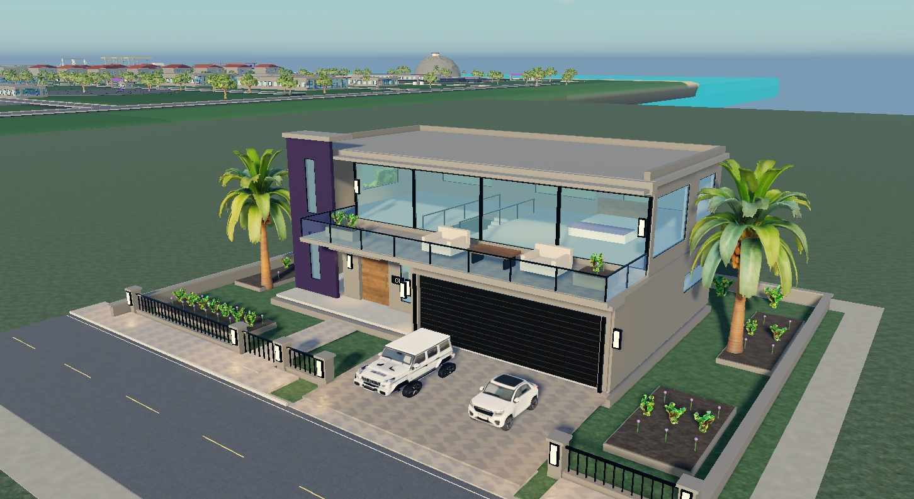

# Casa del centro: molde 3D v1

Modelo aplicado y revisado en Roblox Studio el 24 de octubre de 2026. Esta imagen es una captura real del modelo; no es una imagen generada con IA.



## Modelo en Studio

`Workspace > Moldes_Arquitectura > Casa_Centro_Molde_V1`

Copia reutilizable: `ServerStorage > Moldes_Reutilizables > Casa_Centro_Molde_V1`.

Se construyó en una parcela de muestra separada, conservando la ciudad existente. Incluye dos plantas, volumen violeta, fachada beige, ventanales con marcos, balcón con barandas de vidrio, garaje doble, 21 escalones interiores, mobiliario básico, jardín, cerco, acceso y vereda. Los vehículos son decorativos.

## Generador

`MoldeCasaCentroV1.luau` contiene el ModuleScript constructor. Dentro del proyecto actual utiliza los materiales `CiudadV2_*` de MaterialService y los recursos de `ServerStorage.BibliotecaVisual`.

```lua
local constructor = require(game.ServerStorage.MoldeCasaCentroV1)
local casa = constructor.build(workspace, CFrame.new(0, 0, 0))
```

## Verificación

508 piezas; ninguna sin anclar; ningún personaje ni script activo. Se revisaron el frente y el balcón y se corrigió el exceso de un ventanal. Las puertas y el portón son estáticos. La revisión jugable de los accesos y las mecánicas queda pendiente.

Los registros previos y la primera iteración se conservaron en `ServerStorage.Registro_Antes_MoldeCasa_V1`. Los respaldos permanecen dentro de Studio; no equivalen a un archivo RBXL independiente.
